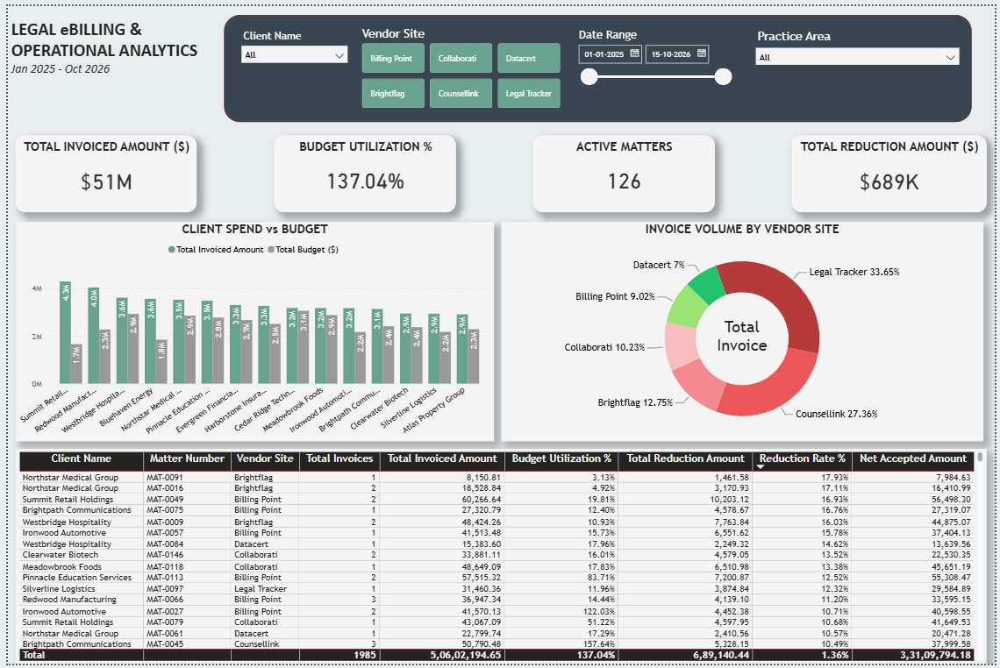

# Legal eBilling and Billing Operations Analysis

I built this project to practise Excel, SQL and Power BI using a topic related to my eBilling experience. It looks at invoice activity, rejections, reductions, appeal recoveries and matter budgets.

The **AI-generated synthetic dataset** contains **1,985 cleaned invoices, 150 matters and 15 clients**. Invoice dates cover January 2025 to 15 October 2026.

## Dashboard

## What I did

- Cleaned the data and calculated descriptive statistics in Excel.
- Used SQL Server to analyse billing, rejection reasons, reductions, budgets and processing time.
- Built a Power BI model and dashboard with client, portal, date and practice-area filters.
- Compared counts and financial totals across all three tools.

## Key findings

- Gross invoicing totals **$50.60 million**.
- Reductions total **$689,140.44**. Accepted appeals offset **$339,087.46**, or **49.20%**.
- Rate and budget approval reasons account for **77.65% of rejected invoices**. These would be my first checks before submission.
- Legal Tracker and CounselLink handle **61.01% of invoice count**.
- Invoicing is **137.04% of recorded budgets**. Budget periods need checking before treating this as confirmed overspending.

Net Accepted Amount is **$33,109,794.18**: invoice value minus reductions plus accepted appeals for Approved, Exported for Payment, Paid and Reduced invoices. It is not cash collected.

## Project files

- [Data](Data/) contains the raw and cleaned workbooks, the Power BI source workbook and the three CSVs for SQL.
- The SQL script contains the analysis queries. [SQL script](SQL/Legal_eBilling_Analysis.sql)
- Open the dashboard in Power BI Desktop. [Power BI file](PowerBI/Legal_eBilling_Dashboard.pbix)
- The report covers the methodology, findings and recommendations. [Project report](Legal_eBilling_Project_Report.docx)
- The data dictionary describes the dataset fields. [Data dictionary](Legal_eBilling_Data_Dictionary.xlsx)

To explore the project, start with the dashboard image and report. To run it, import the corrected CSVs into SQL Server before running the script. Open the PBIX in Power BI Desktop, point its Excel source to `Data/PowerBI_DataSource.xlsx` and refresh.

## Notes

Eight invoice date sequences were adjusted as an assumption and remain included; the report lists them. Rate-based analysis was left out because only 37 invoices matched the reference table. October 2026 is partial, and status dates include simulated future outcomes. Missing receipt and due-date details prevent verified collections or overdue-ageing analysis.

**Author:** Sumit Swami
